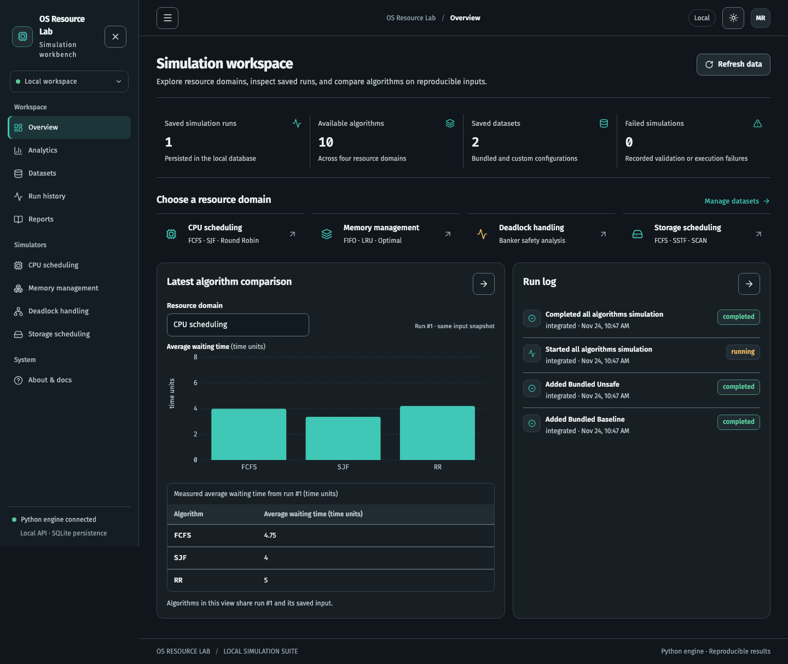
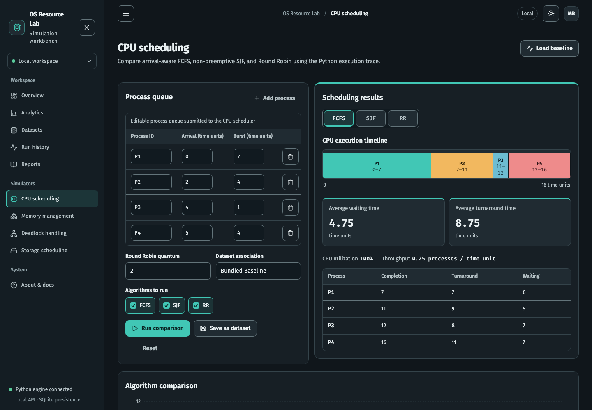
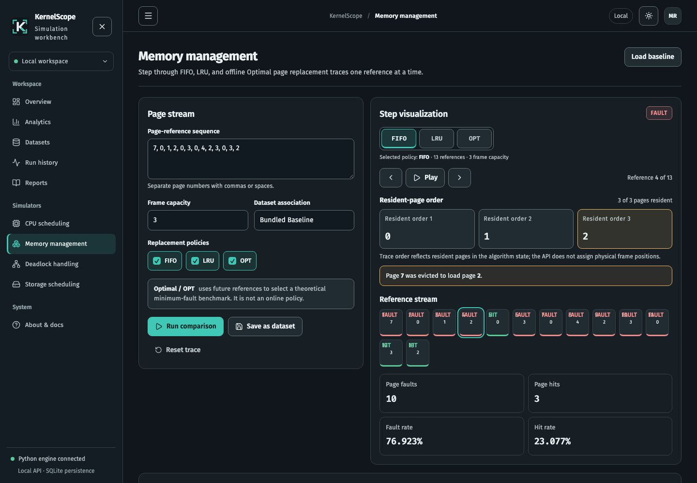
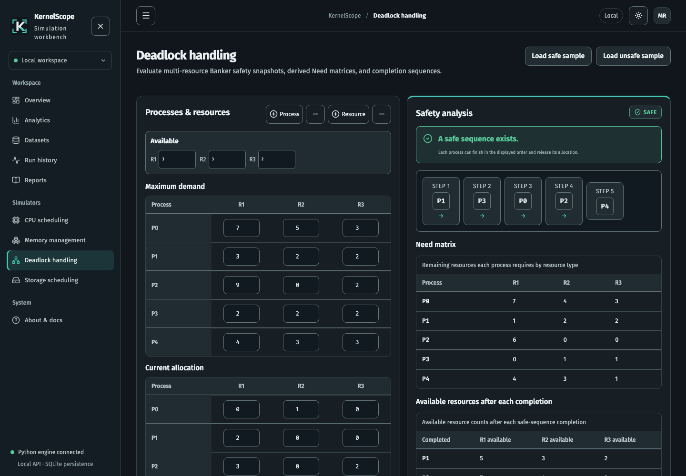
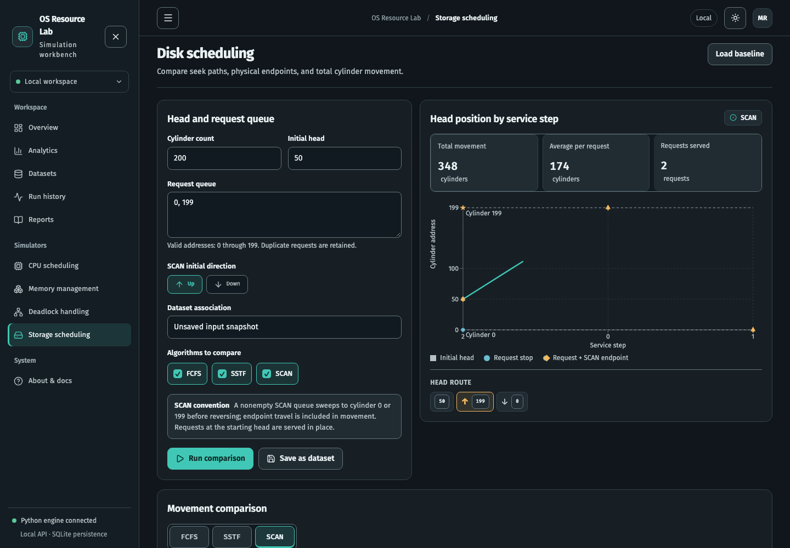
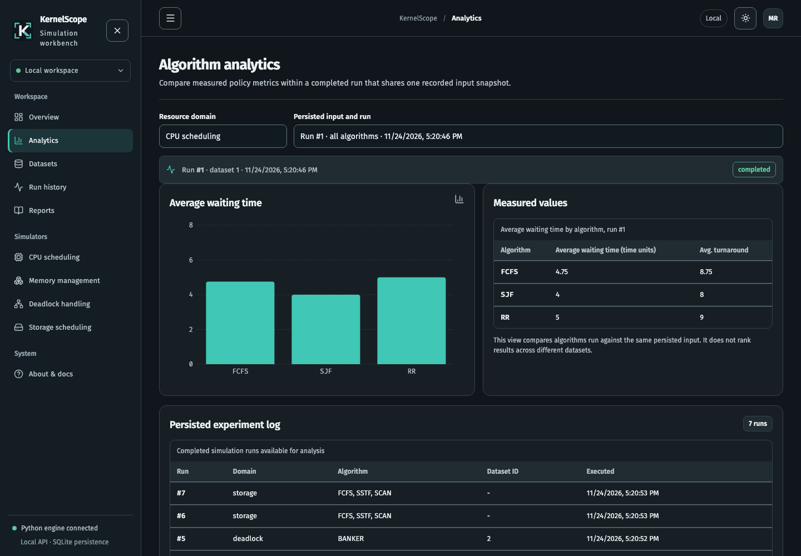
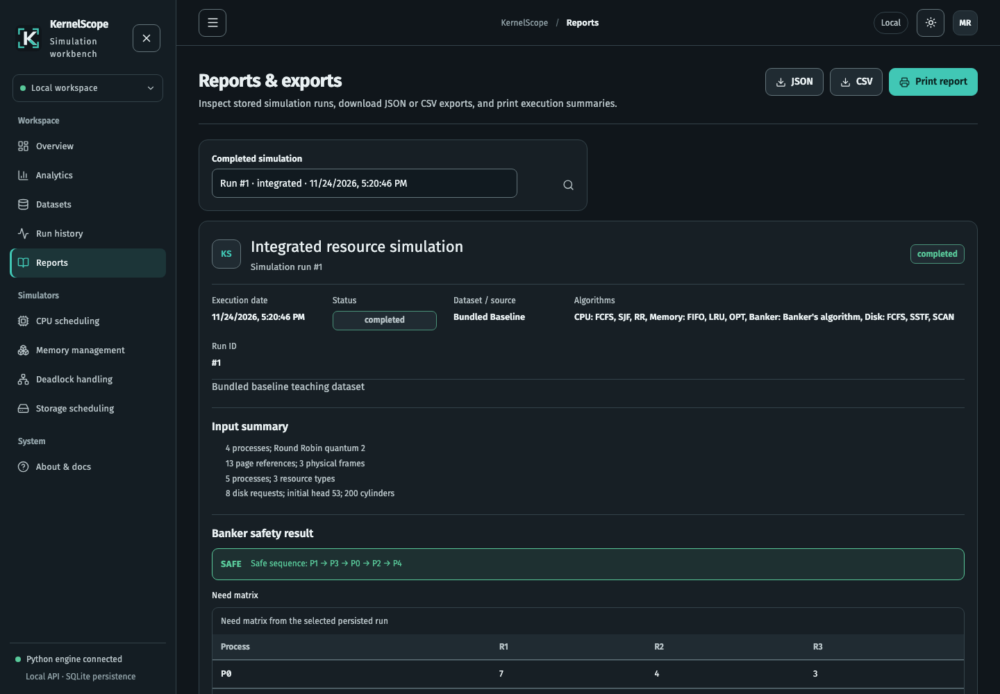
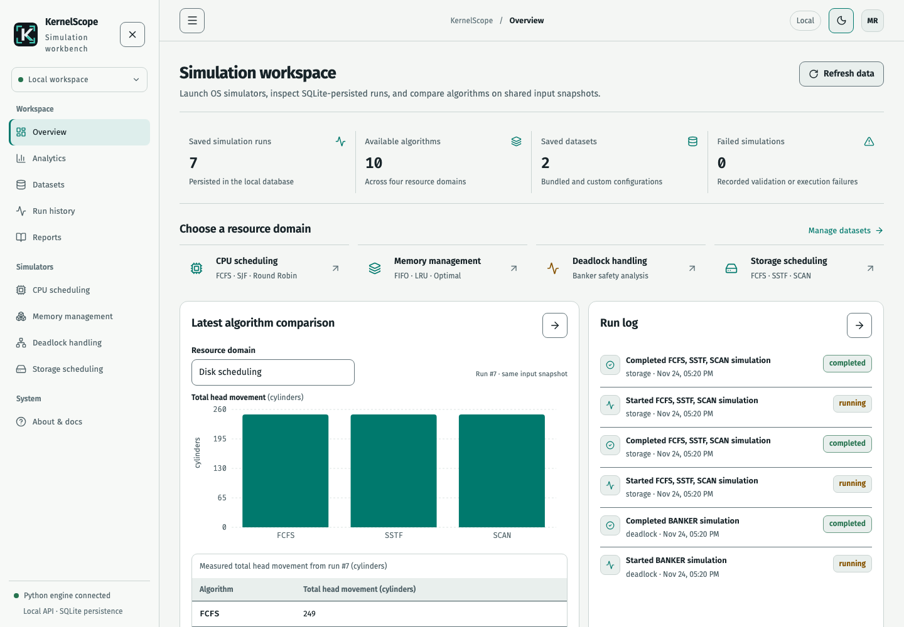
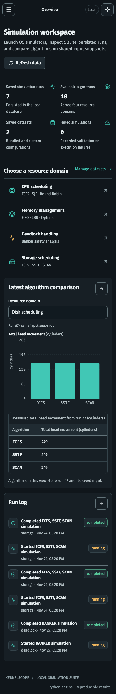
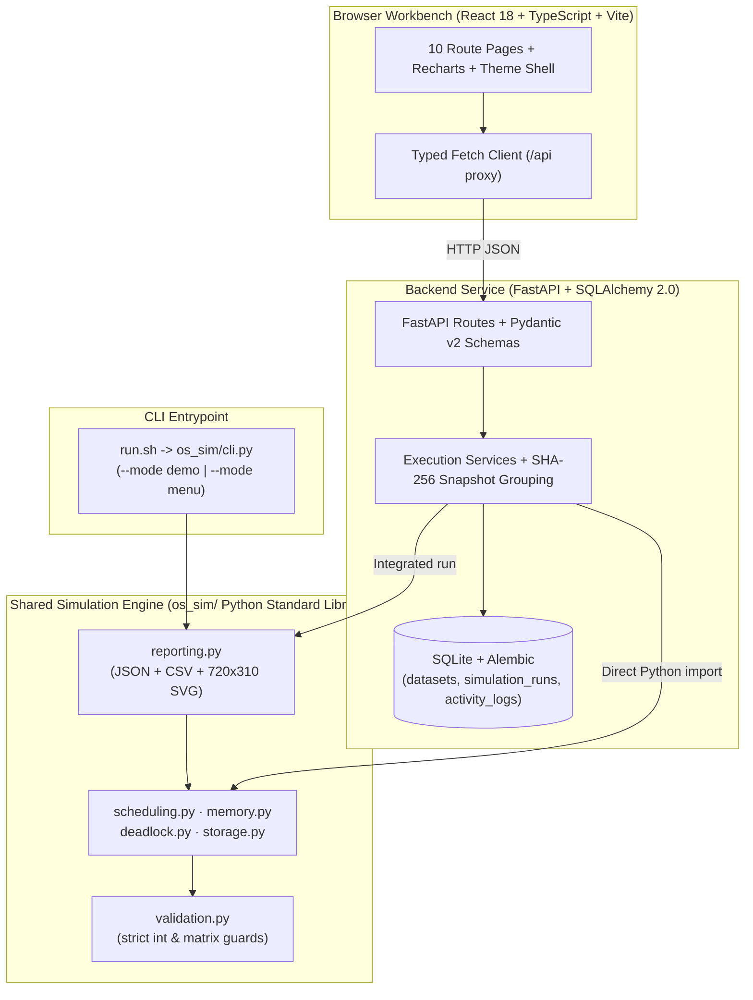

<div align="center">


### Operating-system resource simulation and algorithm analytics workbench

[](https://github.com/MRINALPRAKASHFSD/Kernel_Scope/actions/workflows/ci.yml)


[-c93c37)](LICENSE)

[Quick Start](#quick-start) · [Workbench Preview](#workbench-preview) · [Architecture](#architecture) · [Algorithms & Policies](#algorithms-and-policy-rules) · [API Reference](#rest-api-endpoints) · [Testing](#testing-and-verification) · [Documentation](#documentation-and-policies)

</div>

---

## Overview

**KernelScope** pairs a dependency-free Python and Bash command-line simulator (`os_sim/` + `run.sh`) with a local React, TypeScript, FastAPI, and SQLite web workbench (`start_web.sh`). Both entry points execute the exact same Python functions inside `os_sim/`, so CPU scheduling, virtual-memory page replacement, multi-resource Banker safety analysis, and disk seek routes are never duplicated in JavaScript.

Every simulation run validates its input contract up front, stores an immutable JSON snapshot of the submitted workload alongside the computed step-by-step trace in SQLite, and exports reproducible results as JSON, CSV tables, printable execution summaries, and standalone SVG bar charts.

| Subsystem | Implemented policies | Primary metrics and trace outputs |
|---|---|---|
| **CPU Scheduling** | Arrival-aware `FCFS`, non-preemptive `SJF`, `Round Robin` (`RR`) | Gantt dispatch intervals with `IDLE` spans, per-process completion / turnaround / waiting, CPU utilization, throughput |
| **Memory Management** | `FIFO`, `LRU`, offline `Optimal` (`OPT` benchmark) | Step-by-step resident-page order, `HIT` / `FAULT` classification, evicted-page tracking, hit and fault rates |
| **Deadlock Handling** | Multi-resource `Banker's Safety Algorithm` | Derived `Need` matrix, `SAFE` / `UNSAFE` verdict, safe completion order (or unfinished set), post-release `Work` trace |
| **Disk Scheduling** | `FCFS`, `SSTF`, full-sweep `SCAN` (`up` / `down`) | Ordered cylinder route, physical `SCAN` boundary stops (`0` and `cylinders - 1`), total and per-request head movement |
| **Workspace & Exports** | Dataset CRUD, Run History, Analytics, Printable Reports | SQLite snapshots, SHA-256 same-input comparison groups, one-click replay, JSON / CSV / SVG exports |

---

## Workbench preview

<div align="center">
  
  <p><sub>Overview dashboard displaying live SQLite counters, simulator launch cards, recent activity, and within-run policy comparisons.</sub></p>
</div>

| CPU Scheduling (`/cpu`) | Memory Management (`/memory`) |
|---|---|
|  |  |
| Backend Gantt timeline with synthesized `IDLE` spans and waiting/turnaround metrics. | Step-through resident-page order, `HIT`/`FAULT` chips, and evicted-page tracking. |

| Banker Safety (`/deadlock`) | Disk Arm Scheduling (`/disk`) |
|---|---|
|  |  |
| Multi-resource `SAFE` sequence (`P1 -> P3 -> P0 -> P2 -> P4`) and post-release `Work` trace. | Full-sweep `SCAN` route distinguishing request stops from cylinder `199` boundary turns. |

<details>
<summary><strong>View Analytics, Printable Reports, Light Theme, and Mobile (375 px) captures</strong></summary>
<br />

| Persisted Analytics (`/analytics`) | Execution Reports (`/reports`) |
|---|---|
|  |  |

| Light Theme (`data-theme="light"`) | Mobile Drawer & Responsive Layout (`375 px`) |
|---|---|
|  |  |

Full mapping of all 13 Playwright Chromium captures lives in [`evidence/INDEX.md`](evidence/INDEX.md).

</details>

---

## Architecture



### Technology stack

| Layer | Technologies | Notes |
|---|---|---|
| **Simulation Core** | Python `3.9+` standard library (`os_sim/`) | Pure functions (`scheduling`, `memory`, `deadlock`, `storage`, `reporting`, `validation`) |
| **CLI & Launchers** | Bash (`run.sh`, `start_web.sh`), `argparse`, `logging` | Portable root resolution, UTC launch logs, exit code `2` on invalid input |
| **Backend API** | Python `3.11+`, FastAPI, Pydantic v2, Uvicorn | Strict request validation, `422` activity logging, CSV/JSON report streaming |
| **Persistence** | SQLite, SQLAlchemy 2.0, Alembic (`0001_initial.py`) | Foreign-key enforcement, immutable `input_snapshot` records, idempotent startup seed |
| **Frontend UI** | React `18.3`, TypeScript `5.8`, Vite `6.4`, Tailwind CSS, Recharts, Lucide | Dark/light token system (`Fira Sans` + `Fira Code`), 4-viewport responsive layout |
| **Automated QA** | `unittest` (30), `pytest` (9), `Vitest` (26), Playwright Chromium (9), GitHub Actions | 74 automated tests across CLI, REST/DB, component, and real browser layers |

---

## Quick start

### Prerequisites

- **CLI only**: Python `3.9+`, Bash, and a terminal (zero third-party `pip` packages required).
- **Full-stack web workbench**: Python `3.11+`, Node.js `20+` with `npm`, and Bash (macOS, Linux, or WSL; Windows PowerShell can run `python -m os_sim.cli --mode demo` directly).

### 1. Run the command-line simulator

```bash
git clone https://github.com/MRINALPRAKASHFSD/Kernel_Scope.git
cd Kernel_Scope

chmod +x run.sh
./run.sh --mode demo --dataset samples/baseline.json --output outputs
./run.sh --mode menu
```

| Menu key | Action |
|---|---|
| `1` | Run shared analysis and print **CPU scheduling** Gantt intervals and metrics |
| `2` | Run shared analysis and print **Memory page replacement** step traces and fault rates |
| `3` | Run shared analysis and print **Banker's safety** `Need` matrix and sequence |
| `4` | Run shared analysis and print **Disk scheduling** cylinder routes and movement totals |
| `5` | Run all 10 policies and export `results.json`, `*.csv`, and `*.svg` into `outputs/` |
| `6` | Switch active JSON dataset path (validated on execution) |
| `0` | Exit cleanly (`Goodbye`) |

### 2. Launch the full-stack web workbench

`start_web.sh` creates `backend/.venv` if missing, installs backend and frontend packages locally, applies `alembic upgrade head`, and starts both servers on loopback (`127.0.0.1`):

```bash
chmod +x start_web.sh
./start_web.sh
```

- **Web Workbench**: http://localhost:5173
- **Interactive OpenAPI Docs**: http://localhost:8000/docs
- Stop both servers cleanly with `Ctrl+C`.

<details>
<summary><strong>Manual two-terminal startup and environment variables (.env)</strong></summary>

```bash
python3 -m venv backend/.venv
backend/.venv/bin/python -m pip install -r backend/requirements.txt
npm --prefix frontend ci
cp .env.example .env   # optional; defaults work out of the box

PYTHONPATH=. backend/.venv/bin/alembic -c backend/alembic.ini upgrade head
PYTHONPATH=. backend/.venv/bin/uvicorn backend.app.main:app --host 127.0.0.1 --port 8000

# In a second terminal:
npm --prefix frontend run dev -- --host 127.0.0.1
```

| Variable | Default | Purpose |
|---|---|---|
| `DATABASE_URL` | `sqlite:///.../backend/data/os_resource_lab.db` | SQLAlchemy connection URL (retains original filename for Alembic compatibility) |
| `CORS_ORIGINS` | `http://localhost:5173,http://127.0.0.1:5173` | Comma-separated origins permitted by FastAPI CORS middleware |

</details>

---

## Algorithms and policy rules

### Input validation contract

Integrated JSON datasets (see [`samples/baseline.json`](samples/baseline.json)) require four top-level keys: `processes`, `memory`, `deadlock`, and `storage`, with optional `quantum` and disk `direction` (`"up"` or `"down"`).

- **Strict integer guard**: `os_sim/validation.py` checks `type(value) is int`, rejecting Python `bool` values (`True` / `False`) even though `bool` subclasses `int`.
- **Bounds**: `arrival >= 0`, `burst >= 1`, `quantum >= 1`, `frames >= 1`, `page >= 0`, `cylinders >= 1`, and `0 <= head, request < cylinders`.
- **Process and matrix invariants**: PIDs must be unique non-empty strings; Banker matrices (`available`, `maximum`, `allocation`) must match dimensions `(n processes x r resources)` with `0 <= allocation[i][j] <= maximum[i][j]`.

### Deterministic policy rules

- **CPU Scheduling (`os_sim/scheduling.py`)**: Models a single core with integer clock ticks, no priorities, and zero context-switch overhead. `FCFS` sorts stably by `(arrival, input_index)`. Non-preemptive `SJF` selects minimum `(burst, arrival, input_index)` among arrived processes, advancing `clock` to the next arrival when the ready set is empty. `RR` runs up to `quantum` ticks per turn and enqueues newly arrived processes (`arrival <= clock`) ahead of the preempted process. CPU utilization is measured over `[min(arrival), max(completion)]`.
- **Page Replacement (`os_sim/memory.py`)**: `FIFO` evicts the resident page with the earliest load step; `LRU` evicts the resident page with the oldest recent access step. `OPT` inspects future references `references[step + 1:]` and evicts the page needed farthest ahead (or `inf` if never referenced again), acting strictly as an offline lower-bound benchmark rather than an online OS policy.
- **Banker's Safety Check (`os_sim/deadlock.py`)**: Computes `Need = Maximum - Allocation` and iteratively releases `Allocation[i]` into `Work` for the lowest-index unfinished process with `Need[i] <= Work`. Completing all processes proves the snapshot is `SAFE`. An `UNSAFE` verdict means deadlock avoidance cannot be guaranteed under worst-case remaining requests; it does **not** prove processes are currently deadlocked.
- **Disk Arm Scheduling (`os_sim/storage.py`)**: Measures `sum(abs(route[k + 1] - route[k]))` in cylinders without rotational latency or SSD translation layers. `SSTF` breaks equal-distance ties by original input index. On every non-empty queue, `SCAN` sweeps all the way to physical boundary `cylinders - 1` (`up`) or `0` (`down`), counts that endpoint leg in total movement, and then reverses for opposite-side requests. Requests at the initial head add no duplicate stop, and an empty queue stays at `[head]` with `0` movement.

### Verified baseline benchmarks (`samples/baseline.json`)

| Domain | Workload summary | Measured results |
|---|---|---|
| **CPU** | 4 jobs (`P1: 0/7`, `P2: 2/4`, `P3: 4/1`, `P4: 5/4`), `RR` quantum `2` | Mean wait: **`SJF` 4.00**, **`FCFS` 4.75**, **`RR` 5.00** time units (`100%` utilization, `0.25` throughput) |
| **Memory** | 13 references (`7, 0, 1, 2, 0, 3, 0, 4, 2, 3, 0, 3, 2`), `3` frames | Page faults: **`OPT` 7** (`53.846%`), **`LRU` 9** (`69.231%`), **`FIFO` 10** (`76.923%`) |
| **Deadlock** | 5 processes (`P0..P4`), 3 resource types, `Available = [3, 3, 2]` | **`SAFE`** sequence: `P1 -> P3 -> P0 -> P2 -> P4` (final `Work = [10, 5, 7]`) |
| **Disk** | 8 requests (`98, 183, 37, 122, 14, 124, 65, 67`), `head = 53`, `200` cyl, `SCAN up` | Total movement: **`SSTF` 236**, **`SCAN` 331**, **`FCFS` 640** cylinders |

Step-by-step hand verification of every baseline figure is documented in [`docs/CORRECTNESS_REVIEW.md`](docs/CORRECTNESS_REVIEW.md) and [`docs/REPORT.md`](docs/REPORT.md).

---

## REST API endpoints

| Method & Path | Description |
|---|---|
| `GET /api/health`, `GET /api/algorithms` | Service health status and 10-algorithm metadata catalog |
| `GET /api/dashboard/summary` | Saved run count, dataset count, failed count, 5 recent runs, and 8 recent activity entries |
| `POST /api/simulations/{cpu,memory,deadlock,disk}` | Validate domain input, execute `os_sim`, persist snapshot + trace, and return run record |
| `POST /api/simulations/integrated` | Execute all 10 policies across one integrated dataset |
| `GET /api/simulations`, `GET/DELETE /api/simulations/{id}` | List, reopen, or delete persisted simulation runs (preserving unlinked activity logs) |
| `GET/POST /api/datasets`, `GET/PUT/DELETE /api/datasets/{id}` | List, validate/create (`201`), update, or delete datasets (keeping past run snapshots intact) |
| `POST /api/datasets/{id}/duplicate`, `GET /api/datasets/{id}/export` | Clone a dataset or download `dataset-{id}.json` |
| `GET /api/analytics/overview`, `GET /api/analytics/comparisons` | Workspace totals and runs grouped by `(category, sha256(input_snapshot)[:12])` |
| `GET /api/reports/{id}`, `GET /api/reports/{id}/export?format=json\|csv` | Fetch completed report data or stream `simulation-{id}.{json,csv}` |

Invalid payloads return HTTP `422` with field-level Pydantic details and append a `request.invalid` entry to `activity_logs` without creating a completed simulation row.

---

## Testing and verification

KernelScope includes **74 passing automated tests** across four independent test runners, plus TypeScript project-reference checking and Vite production bundling:

| Suite | Count | Command | Coverage scope |
|---|---:|---|---|
| **CLI & Engine (`unittest`)** | `30` | `python3 -m unittest discover -s tests -v` | All 10 algorithms, tie-breakers, `SCAN` boundaries, boolean/negative rejections, CSV/JSON/SVG exports, CLI logs |
| **Backend API (`pytest`)** | `9` | `PYTHONPATH=. backend/.venv/bin/python -m pytest backend/tests -q` | FastAPI endpoints, `422` validation audit logs, SQLite restart persistence, Banker `declared_totals`, CSV/JSON exports |
| **Frontend UI (`Vitest`)** | `26` | `npm --prefix frontend test` | Input parsers, `Request + SCAN endpoint` markers, domain formatters, simulator states, API error retry flows |
| **Browser E2E (`Playwright`)** | `9` | `npm --prefix frontend run test:e2e` | Live Vite + FastAPI over isolated SQLite, all 10 routes, brand/favicons, themes, `375 / 768 / 1024 / 1440 px` bounds, zero console errors |

Run the complete local verification suite from a clean checkout:

```bash
python3 -m venv backend/.venv
backend/.venv/bin/python -m pip install -r backend/requirements.txt
npm --prefix frontend ci
(cd frontend && npx playwright install chromium)

./run.sh --mode demo --dataset samples/baseline.json --output outputs
./run.sh --mode demo --dataset samples/unsafe.json --output outputs/unsafe_case
python3 -m unittest discover -s tests -v
PYTHONPATH=. backend/.venv/bin/python -m pytest backend/tests -q
npm --prefix frontend test
(cd frontend && npx tsc -b --pretty false)
npm --prefix frontend run build
npm --prefix frontend run test:e2e
```

---

## Repository layout

```text
Kernel_Scope/
├── .github/
│   ├── ISSUE_TEMPLATE/            # Structured bug report and feature proposal forms
│   ├── PULL_REQUEST_TEMPLATE.md   # Pre-PR verification checklist
│   └── workflows/ci.yml           # GitHub Actions CI (CLI, FastAPI/pytest, Vitest, Vite build)
├── backend/
│   ├── alembic/                   # Schema migration environment and 0001_initial.py
│   ├── app/                       # FastAPI main, routes, Pydantic schemas, services, ORM models
│   └── tests/                     # 9 pytest API and SQLite persistence tests
├── design-system/os-resource-lab/ # KernelScope UI token, typography, and chart spec (MASTER.md)
├── docs/                          # Phase design, web architecture, report, test plan, demo guides
├── evidence/
│   ├── browser/                   # 13 Playwright Chromium screenshots of live KernelScope routes
│   └── INDEX.md                   # Route-by-route screenshot and state map
├── frontend/
│   ├── e2e/acceptance.pw.ts       # 9 Playwright Chromium end-to-end acceptance tests
│   ├── public/                    # KernelScope SVG/PNG brand marks and favicons
│   └── src/                       # App shell, shared UI primitives, helpers, 10 pages, 26 Vitest tests
├── os_sim/                        # Shared standard-library Python simulation package
│   ├── cli.py                     # Batch demo runner, interactive 0-6 menu, activity logging
│   ├── deadlock.py                # Multi-resource Banker's safety check
│   ├── memory.py                  # FIFO, LRU, and offline OPT page replacement
│   ├── reporting.py               # Integrated analyze(), CSV writer, standalone SVG bar charts
│   ├── scheduling.py              # Arrival-aware FCFS, non-preemptive SJF, Round Robin
│   ├── storage.py                 # FCFS, SSTF, and full-sweep SCAN disk scheduling
│   └── validation.py              # Strict integer, list, and rectangular matrix guards
├── outputs/                       # Verified baseline and unsafe JSON, CSV, and SVG exports
├── samples/                       # baseline.json, unsafe.json, and invalid.json fixtures
├── tests/test_simulator.py        # 30 CLI and algorithm unittest cases
├── run.sh                         # Portable Bash CLI entrypoint
├── start_web.sh                   # Local FastAPI + Vite full-stack launcher
├── CITATION.cff                   # Academic software citation metadata
├── CHANGELOG.md                   # Release and milestone history
├── CODE_OF_CONDUCT.md             # Contributor Covenant code of conduct
├── CONTRIBUTING.md                # Maintainer workflow and architectural invariants
├── LICENSE                        # Proprietary License (All Rights Reserved)
└── SECURITY.md                    # Local deployment scope and vulnerability reporting policy
```

---

## Documentation and policies

### Technical documentation

| Document | Contents |
|---|---|
| [`docs/DESIGN_AND_PLAN.md`](docs/DESIGN_AND_PLAN.md) | Phase 1 layered CLI data flow, internal data structures, metric equations, and tradeoffs |
| [`docs/WEB_ARCHITECTURE.md`](docs/WEB_ARCHITECTURE.md) | FastAPI/SQLite/React boundaries, ORM schema, REST contracts, and compatibility paths |
| [`docs/REPORT.md`](docs/REPORT.md) | Phases 3 & 5 experimental method, baseline comparison tables, and policy tradeoff analysis |
| [`docs/CORRECTNESS_REVIEW.md`](docs/CORRECTNESS_REVIEW.md) | Hand-worked CPU, memory, Banker, and `SCAN` traces verifying measured outputs |
| [`docs/TEST_PLAN.md`](docs/TEST_PLAN.md) | `T01` through `T30` unit test matrix plus `pytest`, `Vitest`, and Playwright coverage |
| [`docs/DEMONSTRATION.md`](docs/DEMONSTRATION.md) | 5 to 7 minute CLI terminal demonstration sequence and instructor Q&A |
| [`docs/WEB_DEMONSTRATION.md`](docs/WEB_DEMONSTRATION.md) | Live VS Code browser walkthrough and 6-minute spoken presentation script |
| [`docs/MILESTONE_NOTES_NOV14_NOV21.md`](docs/MILESTONE_NOTES_NOV14_NOV21.md) | Retrospective review (`2026-11-24`) of the Nov 14 CLI and Nov 21 simulator UI milestones |
| [`design-system/os-resource-lab/MASTER.md`](design-system/os-resource-lab/MASTER.md) | Semantic color palette, WCAG contrast ratios, typography scale, and trace visual rules |
| [`docs/FINAL_AUDIT.md`](docs/FINAL_AUDIT.md) & [`docs/SUBMISSION_CHECKLIST.md`](docs/SUBMISSION_CHECKLIST.md) | Five-phase capstone deliverable audit and pre-submission student checklist |

### Troubleshooting

- **Port `5173` or `8000` already in use**: Run `lsof -nP -iTCP:5173 -iTCP:8000 -sTCP:LISTEN` and stop any earlier `start_web.sh` session with `Ctrl+C`.
- **Backend import or migration error**: Confirm `python3 --version` is `3.11+`, run `backend/.venv/bin/python -m pip install -r backend/requirements.txt`, and apply `PYTHONPATH=. backend/.venv/bin/alembic -c backend/alembic.ini upgrade head`.
- **Dataset rejected with exit status `2`**: Compare required top-level keys, matrix dimensions, and integer bounds against [`samples/baseline.json`](samples/baseline.json) (`samples/invalid.json` intentionally exits with status `2`).

### Copyright, license, and academic integrity

- **Copyright & License**: **Copyright (c) 2026 Mrinal Prakash. All Rights Reserved.** This repository is proprietary software; unauthorized use, copying, modification, forking, redistribution, or commercial/academic reuse is strictly prohibited without prior written consent. See [LICENSE](LICENSE) for full terms.
- **Policies**: Review [SECURITY.md](SECURITY.md), [CONTRIBUTING.md](CONTRIBUTING.md), [CODE_OF_CONDUCT.md](CODE_OF_CONDUCT.md), [CHANGELOG.md](CHANGELOG.md), and [CITATION.cff](CITATION.cff).
- **Academic integrity**: When submitting coursework based on this repository, include your student metadata, citations, and any AI-assistance or authorship disclosures required by your institution (`docs/SUBMISSION_CHECKLIST.md`), and make sure you can walk through every algorithm trace and modeling assumption live.
